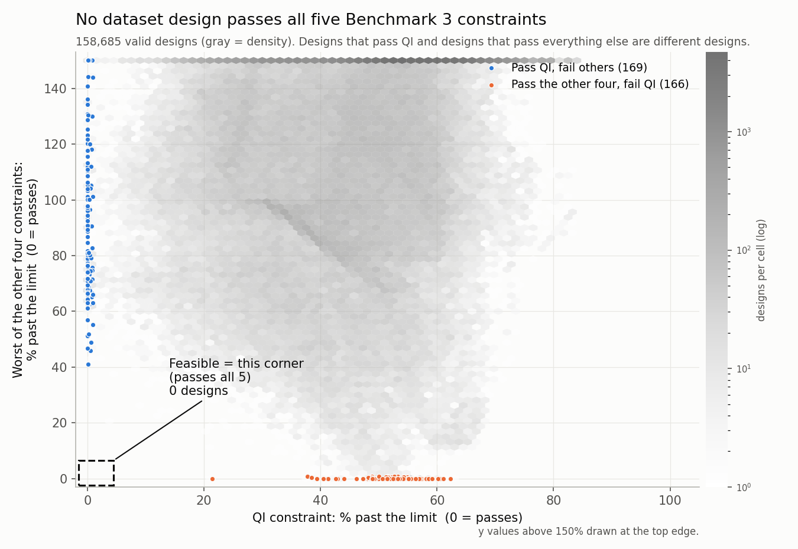
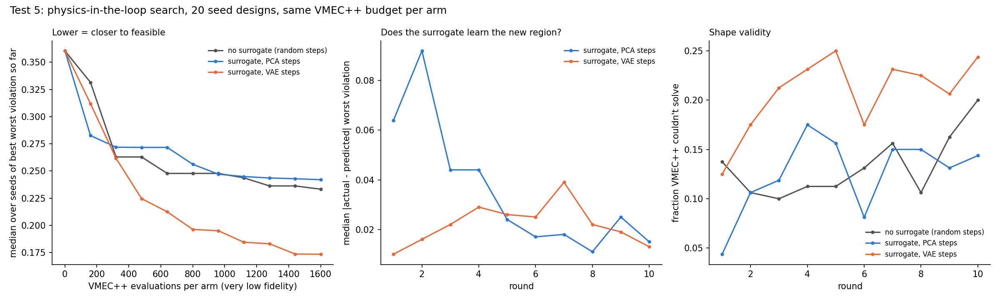

# 2.156 — Final Project: Learned Search for Easier-to-Build Stellarators

Fall 2026. MIT. 2.156 AI & ML for Engineering Design

Fatak Borhani, Joel Pederson, & Leif Akerley

> **Start here.** This README is the project pitch: what we're doing, what every term
> means, what we've found so far, and the plan. Setup and scripts are at the bottom.
> *Drafted 2026-11-11 by Leif with Claude. Edit anything you disagree with.*

Key dates: mid-term report Wed Nov 18 · **results freeze Mon Nov 30** · poster Fri Dec 4 · poster session + final report Wed Dec 9.

Two tracks: **Track A** (Leif) starts from the dataset alone, where no design passes; see
"What the feasibility tests showed". **Track B** (Joel) starts from the passing designs other
teams posted to the public leaderboard; see "Track B".

---

## The pitch in one paragraph

Designing a stellarator (a twisted-magnet fusion device) today means running a slow
physics simulation inside an optimizer for 15–40+ hours, and it often ends with no
design that meets the requirements. We'll use the open
**[ConStellaration](https://github.com/proximafusion/constellaration)** dataset (from
Proxima Fusion, NeurIPS 2025) to train ML models that predict the physics. We'll then
search with those models and only run the real simulation on the most promising
candidates. **The question: can we find designs that meet the benchmark's requirements
using far fewer physics simulations than the paper's optimizer baseline?** This is
Idea 03 from our 3-ideas presentation (`Docs/3-ideas-presentation.key.pdf`).

---

## How the problem works

### What we design (inputs)

A design is the **shape of the plasma's outer boundary**, a twisted 3D donut. It's
stored as Fourier coefficients (`boundary.r_cos`, `boundary.z_sin` in the dataset),
**about 80 numbers**, plus the number of field periods (how many times the twist
repeats around the donut). These numbers are the only thing we choose.

### What physics computes from it (outputs)

A physics code called **VMEC++** takes the shape and solves for the magnetic field
inside it (an MHD equilibrium). From that field, the benchmark computes a set of
**metrics**: numbers like QI residual, twist, mirror ratio, vacuum well and aspect
ratio. One run takes **~2 minutes** on one laptop core.

```
shape (~80 numbers)  ──►  VMEC++ physics solve (~2 min)  ──►  metrics  ──►  pass/fail checks  ──►  score
   what we design              the expensive part            outputs        "feasible?"
```

### Benchmark 3: the problem we picked

ConStellaration defines **three benchmark problems**. We're doing **Benchmark 3,
"MHD-stable QI stellarator"**, the most complete of the three: it adds plasma
stability and has two competing goals. It has **5 requirements (constraints)** and
**2 goals (objectives)**.

**The 5 requirements.** A design must pass all of them:

| # | Requirement | Limit | What it means physically |
|---|---|---|---|
| 1 | **QI residual**, log10(qi) | ≤ -3.5 | How close the field is to *quasi-isodynamic*. Good QI keeps fusion-born particles confined and reduces energy losses. **The hardest one.** |
| 2 | **Edge twist** (rotational transform ι per field period) | ≥ 0.25 | How much the magnetic field lines wind around the plasma edge |
| 3 | **Edge mirror ratio** | ≤ 0.25 | How much the field strength varies along the plasma edge |
| 4 | **Flux compression in bad curvature** | ≤ 0.9 | A geometric stand-in for turbulence, which drives heat loss |
| 5 | **Vacuum well** | ≥ 0 | Whether the plasma is stable against a class of MHD instabilities ("MHD-stable") |

**The 2 goals,** traded off against each other:

- **Maximize L∇B** (normalized magnetic gradient scale length). A smoother field can
  be made by **simpler coils** farther from the plasma. This is the "easier to build" part.
- **Minimize aspect ratio** (major radius ÷ minor radius). A more **compact** device
  is cheaper, but compactness makes the requirements harder to meet.

**The score** is the *hypervolume*: how much of the "simple coils vs. compact" tradeoff
space our set of feasible designs covers. **Designs that fail any requirement count
for nothing.**

*Source:* the limits are hard-coded by the benchmark authors in
[`problems.py` (v0.2.6)](https://github.com/proximafusion/constellaration/blob/v0.2.6/src/constellaration/problems.py),
class `MHDStableQIStellarator`. The physics descriptions above paraphrase that file's
docstrings. The leaderboard scores with exactly this code, so we pin version 0.2.6.

### Key terms (we use these exactly)

| Term | Meaning |
|---|---|
| **Design** | One plasma boundary shape (the ~80 numbers) |
| **Evaluation** | Running VMEC++ on a design to get its metrics. Costs ~2 min of CPU. "Evaluations spent" is how we measure cost. |
| **Valid** | VMEC++ ran successfully on the design, so it has metrics. Some shapes make the solver fail. |
| **Feasible** | Passes **all 5 Benchmark 3 requirements** (within 1% of each limit). This is the benchmark's definition, not ours. |
| **Violation** | How far a metric is past its limit, as a fraction of the limit. Mirror ratio 0.278 vs. limit 0.25 → 11% past. 0 or below means it passes. |
| **Near-feasible** | Valid, fails some requirement, but not by much (e.g. worst violation ≤ 25%) |
| **Surrogate** | An ML model that predicts the metrics from the shape in milliseconds, instead of the ~2-minute VMEC++ run |
| **Fidelity** | VMEC++ accuracy setting. The official score uses **high** (~2 min). The baseline optimizer uses **very low** (2–11 s), whose numbers differ slightly. |

---

## What we found (Nov 11)

### 1. The dataset has 158k valid designs, but none are feasible

| Count | What it is |
|---|---|
| **182,222** | Designs in the dataset |
| **158,685** | **Valid**: VMEC++ produced metrics. The other ~23.5k shapes made the solver fail. |
| **0** | **Feasible** for Benchmark 3 (also 0 for Benchmarks 1 and 2) |
| 10 / 4,490 | Near-feasible: worst violation within 25% / within 50% |

We checked this with the benchmark's own feasibility function (`results/official_feasibility.json`).

**Example: the closest design in the whole dataset.** It passes 2 of 5:

| Requirement | Limit | This design | Pass? |
|---|---|---|---|
| log10(qi) | ≤ -3.5 | -2.79 | ❌ 20% past |
| Edge twist | ≥ 0.25 | 0.268 | ✅ |
| Mirror ratio | ≤ 0.25 | 0.278 | ❌ 11% past |
| Flux compression | ≤ 0.9 | 0.613 | ✅ |
| Vacuum well | ≥ 0 | -0.011 | ❌ 11% past |

### 2. Why: good-QI designs and good-everything-else designs are different designs



- **169 designs pass QI**, but almost all of them fail each of the other four, typically
  by 40–65% (blue, left edge).
- **166 designs pass the other four**, but their QI is far off: median log10(qi) is
  -1.64 against a limit of -3.5 (orange, bottom edge).
- **Nothing sits in the feasible corner.** Most designs fail 3–5 requirements at once.

*Why the data looks like this:* each dataset design was itself produced by a physics
optimization aimed at a randomly sampled target. Those optimizations targeted QI, aspect
ratio, elongation and twist, **never vacuum well or flux compression**, and they didn't
aim at Benchmark 3's limits. So the dataset is "QI-like" but was never trying to pass
this benchmark. Of the 182k rows, 88k came from DESC optimization, 49k from a
near-axis-expansion method, 30k from a simpler initial-guess method, and 16k from VMEC
optimization. (`results/why_infeasible.json`, `scripts/why_infeasible.py`)

### 3. We can run the official evaluation on a laptop, and it matches exactly

- One high-fidelity evaluation takes **~105–160 s on one core and ~3.6 GB of RAM** (M3 Max).
  About 12 run in parallel, so **~400 evaluations per hour**.
- Re-scoring dataset designs reproduces their stored metrics to about 7 decimal places
  (`results/evaluator_check_4designs.jsonl`).

### 4. The baseline optimizer is very expensive

The paper's baseline (augmented Lagrangian + Nevergrad, "ALM-NGOpt") script runs up to
**~1.8 million evaluations** at very low fidelity. The paper splits Benchmark 3 into four
runs (aspect ratio at most 6, 8, 10, 12), each on a **96-vCPU machine for 15–24 hours**:
roughly **1,400–2,300 CPU-hours per run**. It found feasible designs at aspect ratio 8,
10 and 12, but not 6 (worst violation 0.104) ([paper](https://arxiv.org/html/2506.19583v2),
Table 5). That's why "same result, far fewer evaluations" is a meaningful claim. It also
means we can't rerun the full baseline on a laptop.

---

## What the feasibility tests showed (Nov 14–22)

Quick, throwaway checks of the plan's riskiest assumptions, on the 68k designs with 3
field periods. Full write-up, numbers and figures:
**[results/feasibility_tests/SUMMARY.md](results/feasibility_tests/SUMMARY.md)**.

| Test | Question | Answer |
|---|---|---|
| 1 | Can a surrogate predict the metrics, especially QI? | **Yes, on shapes like the dataset.** A neural net gets R² 0.92–0.99 and tracks QI for the best designs; boosted trees don't |
| 4 | Can cheap VMEC++ stand in for the expensive version? | **As a filter, yes.** Very low fidelity is 40× faster (3 s) and ranks designs the same, but its errors (~0.06) are too big for the final verdict |
| 3 | Can shapes be compressed without changing the physics? | **With a VAE, yes.** At 16 numbers it rebuilds designs that all still solve and generates valid shapes ~80% of the time (PCA: 26–52%). But it blurs QI by ~0.2–0.35 in log10 |
| 2, 2b | Does searching on the surrogate, then checking once, find better real designs? | **No.** Most searched shapes break in VMEC++ and none were feasible. The search lands on unfamiliar shapes where the surrogate is confidently wrong (mirror ratio predicted ~0.05, actually 1.4–2.4) |
| 5 | Does a small physics-in-the-loop search work? | **Yes.** In 1,600 cheap VMEC++ runs per method, it found designs about **twice as close to feasible** as anything in the dataset (worst violation 0.203 → **0.096**). VAE steps did best; surrogate + PCA steps were no better than random steps. Nothing feasible yet |
| 6 | Can a longer, focused push reach feasible? | **No.** Best 0.096 → **0.078**, then stuck: no small step improves any of the 5 best designs, which each still fail 3–5 requirements by ~0.08–0.15. Reaching feasible needs a stronger constrained optimizer or new starting points |
| 7 | Does the paper's optimizer (ALM-NGOpt) finish the job from our best design? | **No, not at a budget we can afford.** 5,400 cheap runs from each of 3 starts, nothing feasible. From the same budget: its usual start reached 0.72, the dataset's best 0.126, our design stayed at 0.078 (but found a version with L∇B 9.1 instead of 5.1). **At a matched budget, our loop beats the baseline** |
| 8 | Does that optimizer do better if retuned to polish instead of explore? | **Much better, not feasible yet.** With penalties scaled like the benchmark, a shrinking search box and L∇B only as a tie-breaker, 6,000 cheap runs per design halved the best gap: **0.078 → 0.033** at high fidelity. Only QI and mirror ratio are still ~0.03 short. Still improving when it stopped |
| 9 | Can correcting the cheap search with a few high-fidelity checks per round cross the line? | **Yes: first feasible design.** Worst violation **0.0087** at high fidelity (passes at ≤ 0.01), L∇B 8.59, aspect ratio 12.05, confirmed by a fresh evaluation. Starting only from the dataset, roughly 27 CPU-hours of simulation along the way vs. 1,400–2,300 per run of the paper's baseline. 1 of 3 starts got there |
| 10 | Can we spread out from the feasible design to build our own front? | **Many feasible designs, one point on the front.** 50 feasible designs (the safest passes by a wide margin, 0.0005), but all at aspect ratio 12.0–12.3 with L∇B 8.49–8.59: hypervolume **76.5** (paper's baseline submission 129.8; public designs in this design space 205.5). More compact runs got close (0.016 at aspect ratio 11.5) but not feasible |
| 11 | Can lowering the aspect-ratio limit step by step (no ML) make the front more compact? | **Partly.** Feasible at 11.5; stuck just above 11 (0.013 at 11.05). Hypervolume 81.4 |
| 12 | Do conditional-VAE starting designs help at each limit? | **Same reach, half the cost.** Also feasible only at 11.5, but in half the high-fidelity runs (21 vs. 42) and with simpler coils (L∇B 9.3 vs. 8.6). Hypervolume 87.6 |
| 13 | Can L∇B be raised step by step as a requirement? | **Yes.** 8 of 9 steps: aspect ratio 12.2–16.7, L∇B 10.0–15.9, 195 new feasible designs. Hypervolume **125.3** |
| 14 | Does the same ladder work toward compactness? | **No.** 0 of 7 steps of 0.25 (best 0.011 at 11.34). Hypervolume 128.2 |
| 15 | Do diffusion and VAE starting designs plus the finisher reach new targets? | **Yes, with the finisher.** Raw designs a median 0.16–0.30 from feasible; finished, they reached aspect ratio 10.5, 11 and 16. Hypervolume 136.0 |
| 16 | Does a small-step descent from the most compact design go further? | **To 10.30**, not 10.0 (0.015). Hypervolume 138.6 |
| 17 | Does diffusion trained on our own designs do better? | **No.** No new feasible designs; the surrogate ranked raw diffusion designs no better than chance |
| 18 | Do Fourier modes up to 5×5 and steps of 0.125 break the wall? | **Yes, but from the smaller step.** 6 of 7 targets, aspect ratio down to 9.53, 192 feasible designs; mode-5 coefficients never moved (and `seeded/modes5_control.py` shows the designs pass without them). Hypervolume **144.4** |
| 19 | Can a second family, 4 field periods, start from the dataset? | **Not yet.** 0.32 → 0.027 from feasible, still improving |
| 20 | With modes 4–5 free to move, how compact can we go, and can L∇B rise above our front at aspect ratio 10, 11, 12? | **3 of 3 compactness targets**, most compact feasible 9.23 (L∇B 6.82); L∇B +0.5 reached at 10 and 12, not 11. 689 feasible designs in all, hypervolume **147.2** (paper's baseline 129.8) |

**Test 5 in one picture:** median distance to feasible over 20 seed designs, for three
search methods with the same VMEC++ budget. Lower is better.



**What changes in the plan:**

- **Physics in the loop is the core of the method, not an add-on.** Take small steps with
  the surrogate, check them with very low fidelity VMEC++, add the results to the training
  data, retrain, and repeat. Confirm the best at high fidelity. Test 5 shows this works.
- **Search in a VAE latent space** to stay on shapes VMEC++ can solve, then refine
  finalists in the full coefficients (the VAE blurs QI too much for the last step).
- **Mirror ratio is the surrogate's worst blind spot** on new shapes, then QI and vacuum
  well. Disagreement between ensemble models didn't flag the errors, so we need a better
  safety check (e.g. a trust region around evaluated designs).
- **Always compare against random steps.** In Test 5 the surrogate with PCA steps didn't
  beat plain trial and error. The VAE did, though partly because its steps were bigger.
  That comparison is our honest "does ML help" test.
- **Local polishing stalls around 0.08 (Test 6), and the paper's optimizer doesn't break
  through either (Test 7).** With ~5,000 cheap runs, ALM-NGOpt gets to 0.72 from its usual
  start and 0.126 from the dataset's best, versus 0.078 for our loop: a good sign for the
  baseline comparison.
- **A tuned constrained optimizer finishes what the loop starts (Test 8).** Retuned to
  polish, ALM-NGOpt halved the best gap to **0.033**. Next: continue the best designs,
  and do the last stretch at high fidelity, because the cheap simulator's error (~0.02)
  is now as big as what's left.
- **Correcting the cheap search with high-fidelity checks got us over the line (Test 9).**
  Next: spread out from the feasible design to build a front (compare with the seeded
  track), and let the surrogate screen candidates to cut the cost per feasible design.
- **One feasible design gives many safe copies, but not a front (Test 10).** To cover the
  trade-off between compactness and coil simplicity, we need different starting points:
  smaller aspect-ratio steps chained from the last feasible design, more seeds, or the
  public feasible designs (the seeded track).

---

## Track B: starting from the public designs (Nov 14–22)

*Joel, with Claude Code. Code in `scripts/seeded/`. Every number is from real
high-fidelity simulations with the official scorer (constellaration 0.2.6).*

Track A starts from the dataset, where no design passes. Track B starts from the ~8,000
passing designs (3 field periods, 4×4 modes) that other teams posted to the public
leaderboard, credited by submitter, and asks how cheaply ML can find **new** passing
designs near them. A design counts as ours only if it is at least 0.003 from every public
design (RMS distance between the two surfaces, after putting both in one standard form).

**Scope.** Track B's gains are within the 3-field-period, 4×4 design space, whose public
front scores 205.5. The full leaderboard front (285.3) is made of higher-resolution designs
with 3 and 4 field periods, and nothing in this section improves on it.

| | |
|---|---|
| Scorer check | The paper's baseline re-scores to 129.80; 237 public designs re-score with 0 pass/fail flips |
| Simulations through Nov 18 | 10,054 (~244 CPU-hours), giving 3,864 new passing designs |
| Public 4×4 front + ours | 205.5 → **208.9** (counting only designs ≥ 0.01 from any public one: 207.45) |
| Our designs alone | 206.9 (paper baseline: 129.8) |

What we learned:

1. **Random tweaks fail.** 0 of 784 random perturbations of public designs passed: passing
   designs sit on a thin surface.
2. **Blending works.** Mixing two public designs passes ~44% of the time and fills gaps in
   the front (best: A 14.93 with L∇B 18.27, where the public best was 17.8). Blends are
   interpolations, so we credit both parents.
3. **Closeness decides passing, for every method.** About 99% of designs within 0.005 of a
   public design pass, ~80% at 0.007–0.01, and 9–22% beyond 0.01.
4. **The ML screen pays off where passing is rare.** The screen is gradient-boosted trees on
   the 80 shape coefficients, deciding which candidates to simulate. Equal budgets, 3 seeds
   per arm:
   - On ordinary blends it finds as many new designs as random picks in about half the
     simulations.
   - Restricted to clearly new designs (≥ 0.01), it finds 514 passing designs in 900
     simulations against random's 115 (57% vs 13%).
   - In every comparison the front gain matches random picks.
   - Which model does the screening barely matters (6 compared). What matters is training
     on designs like the ones being judged.
5. **Generators don't help.** VAE, conditional VAE, diffusion and conditional diffusion
   (144 settings tuned offline):
   - The screen predicted 30–97% of their designs would pass; 0–15% did, mostly missing QI
     by a few percent. A Gaussian mixture passed 47%, but only with near-copies.
   - Snapping generated designs back onto the passing surface lifts them to 67–77%, but
     random local blends pass 90%.
6. **Blending can't reach the full front.** At full resolution, blends of front designs land
   0.5–1.5 L∇B below it (`fullres.py`).

### Track B's method on Track A's designs (Nov 21–22)

- **Blending from Leif's designs, no public data** (`track_a_loop.py`; 6 runs, 853
  simulations):
  - Track A's 4×4 front goes from 143.6 to **146.75**; every run adds +2.1 to +2.4.
  - Screened and random picks add the same, and pass 57% vs 52% of the time.
  - The new designs beat Track A's best L∇B at every A from 9.5 to 13, but none is more
    compact than A 10.46.
- **Test 18's designs don't need mode 5** (`modes5_control.py`). All 122 still pass with
  every 5th-order term removed, with unchanged scores. So Track A's best result is a 4×4
  result, directly comparable to the public 4×4 front.

### Running now: refining the leaders' designs (Nov 22–23)

`refine_leaders.py` starts the paper's optimizer (ALM-NGOpt) at 8 designs from the full public
front (A 5.9–19.8). Each run keeps the design's own resolution, scores every step at high
fidelity, and tries to raise L∇B without raising A. The question is whether there is room
above the leaders' front. Results Mon Nov 23.

---

## The plan

### Objective

**Find feasible Benchmark 3 designs using far fewer VMEC++ evaluations than the
ALM-NGOpt baseline.** We report feasible designs found, and their hypervolume, against
evaluations spent, compared with the baseline on the same budget.

**Fallback** if nothing gets fully feasible: report how close we get (smallest worst
violation) against evaluations spent, compared with the baseline. Still a complete result.

### Method

1. **Surrogates.** Train models that predict the 5 requirement metrics and 2 goals from
   the ~80 shape numbers, focusing on **QI** (the hard one). Also train a classifier
   that predicts whether VMEC++ will fail on a shape (from the ~23.5k failures).
   Compare boosted trees with a neural net, with and without PCA on the inputs.
2. **Latent-space search.** Compress the shapes into a few dimensions (PCA or a VAE).
   Search that space with the surrogates for designs predicted to pass all 5,
   **starting from both groups in the figure** (good-QI and good-everything-else).
3. **Physics in the loop.** Run real VMEC++ on the top ~100 candidates, add the results
   to the training data, retrain, and repeat a few rounds. This is needed because the
   dataset has no feasible designs, so the surrogates are guessing exactly where we care
   most. Each round is about an hour on a laptop. The feasibility tests confirmed this is
   essential: steps must be small, and the surrogate must be retrained on what VMEC++
   says about the new shapes.
4. **Compare with the baseline.** Run ALM-NGOpt with the same evaluation budget and
   re-score its outputs at high fidelity.

**Not doing** (unless time allows): diffusion models (no feasible examples to learn
from), the leaderboard, and the dataset's extra DESC-equilibrium and 1%-pressure subsets.

### Who does what (proposed, let's decide)

| Area | Owner |
|---|---|
| Surrogates + VMEC-failure classifier | ? |
| Latent space + search | ? |
| Evaluation pipeline, baseline, final comparison | Leif |

### Milestones

| Date | Deliverable |
|---|---|
| **Wed Nov 18** | Mid-term report: objective, these findings, evaluator + timing, first surrogate accuracy, plan |
| ~Nov 25 | First round of searched designs evaluated with VMEC++ |
| Wed Dec 2 | Physics-in-the-loop rounds and baseline comparison done |
| Fri Dec 4 | Poster due |
| Wed Dec 9 | Poster session (Hart Nautical Gallery) + final report |

### Open questions for the team

- **Baseline:** a reduced-budget run on one aspect-ratio setting, MIT's Engaging
  cluster, or the numbers reported in the paper?
- **Field periods:** restrict to one count or keep all? Valid designs by count:
  1: 14.6k, 2: 19.9k, **3: 68.2k**, 4: 27.8k, 5: 28.1k. The baseline starts from 3.
- **Course staff:** is "feasible designs per evaluation vs. ALM-NGOpt" a convincing
  headline? Ask in our project meeting.
- **Before the report:** check the physics descriptions against the ConStellaration
  paper ([arXiv 2506.19583](https://arxiv.org/abs/2506.19583)).

---

## Setup

Needs a conda installer ([Miniforge](https://github.com/conda-forge/miniforge) recommended)
and ~3 GB of disk (2.3 GB environment + 0.6 GB dataset).

```bash
git clone https://github.com/FatakBorhani/2.156-final-project.git
cd 2.156-final-project
./setup_env.sh                  # creates the "stellarator" env and a Jupyter kernel (several minutes)
conda activate stellarator
```

`setup_env.sh` installs **`constellaration==0.2.6`**, the exact version the leaderboard
scores with. **Don't upgrade it:** 0.3.0 changed Benchmark 3's feasibility math. Tested on
macOS (Apple Silicon). The upstream package is tested on Ubuntu with Python 3.10.

Why a script instead of `mamba env create -f environment.yml`: the package needs
`booz-xform==0.0.9`, which has no prebuilt macOS version and won't compile with
pybind11 3.x. The script compiles it against pybind11 2.x first.

## Scripts

Run from the repo root with the `stellarator` env active. Each script's docstring has details.

| Script | What it does | Time |
|---|---|---|
| `scripts/evaluate.py` | **The evaluator.** Scores designs against Benchmark 3 with VMEC++ in parallel and appends each result to a JSONL log (safe to stop and resume). **Every physics evaluation we count should go through this.** | ~2 min/design/core |
| `scripts/export_designs.py` | Exports the N closest-to-feasible dataset designs in the evaluator's input format | ~2 min |
| `scripts/why_infeasible.py` | The breakdown and figure in "What we found" | ~1 min |
| `scripts/count_feasible.py` | Pass rate of each requirement across the dataset | ~1 min |
| `scripts/check_feasibility.py` | Feasibility counts with the benchmark's own function, all 3 benchmarks | ~2 min |
| `scripts/time_eval.py` | Times one official evaluation | ~2 min |
| `scripts/feasibility_tests/` | The feasibility tests above (surrogate, fidelity, search, PCA vs. VAE, loop, ALM warm start, ALM polish, multi-fidelity, then Tests 11–20: chains, ladders, generative seeds, descents, 5×5 modes, 4 field periods) | 5 min–14 h each |
| `scripts/report_progress_figure.py` | Track A's hypervolume after each test and its current front (`results/report/track_a_progress.png`) | seconds |
| `scripts/seeded/` | Track B; see the next table | |

The first data script downloads the dataset (~600 MB) into the Hugging Face cache.

**Track B (`scripts/seeded/`).** Each script's docstring gives its commands. Simulations go
through `run_sims.py`, which uses the evaluator's worker function with one thread per
simulation and a time limit. One thread per simulation alone took the slowest simulations
from 5–40 minutes to about one, and lifted throughput from ~130 to ~370 per hour on 8 workers.

| Script | What it does |
|---|---|
| `public_designs.py` | Builds the table of public leaderboard designs (and the paper's baseline) |
| `parity_check.py` | Scorer check: do we reproduce the leaderboard's numbers? |
| `shapes.py` · `families.py` | One standard form for boundaries, a distance between them, families and novelty |
| `training_data.py` · `screen.py` | The screening models' training table, and the models |
| `perturb.py` · `surface.py` | No-ML proposers: random tweaks, and blends along the passing surface |
| `loop.py` | The pipeline: propose → screen → simulate, in rounds; screened vs. random arms |
| `run_sims.py` | Parallel simulations, one thread each, with a time limit |
| `generators.py` · `gen_study.py` · `gen_pilot.py` | Generative proposers, their offline trade study, and the real-simulation pilot |
| `repair.py` · `screen_compare.py` | QI repair pilot; six screening models compared, with Shapley values |
| `fullres.py` | Blending at the full leaderboard's resolution |
| `report_numbers.py` | Every Track B number in the mid-term report |
| `track_a_loop.py` · `modes5_control.py` | Track B's method on Track A's designs; Test 18 without mode 5 |
| `refine_leaders.py` | The paper's optimizer, started at the full front's designs |

Figures: `notebooks/seeded_figures.ipynb` and `notebooks/generator_trade_study.ipynb`,
saved to `results/seeded/` and `results/generators/`.

Evaluator input is one design per line, `{"id": ..., "boundary": <SurfaceRZFourier JSON>}`:

```bash
python scripts/export_designs.py data/near_feasible_100.jsonl --n 100
python scripts/evaluate.py data/near_feasible_100.jsonl results/runs/seed100.jsonl --workers 12
```

From a notebook or your own script: `sys.path.append("scripts")`, then
`from evaluate import evaluate_designs, summarize`. The evaluator uses worker processes,
so in a `.py` file call it under `if __name__ == "__main__":`. Piping code into
`python -` won't work on macOS.

## Layout

```
Docs/          presentations, figures/
scripts/       evaluator + dataset analysis; feasibility_tests/ (Track A), seeded/ (Track B)
notebooks/     Track B figures
results/       small outputs worth keeping: feasibility_tests/, seeded/, generators/, report/
data/          local inputs, simulation logs and scratch outputs (gitignored)
```

## AI use

Claude (Claude Code) helped set up the environment, write the scripts in `scripts/`,
analyze the dataset, make the figure, and draft this README. For Track B, Claude Code wrote
the code in `scripts/seeded/` and the notebooks, ran and monitored the simulation campaigns,
and drafted the Track B section, at Joel's direction. The course requires an
AI-use statement on every submission, so keep this section current.
