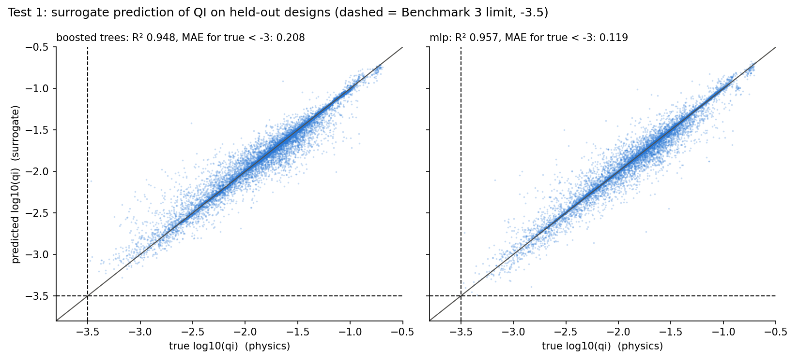
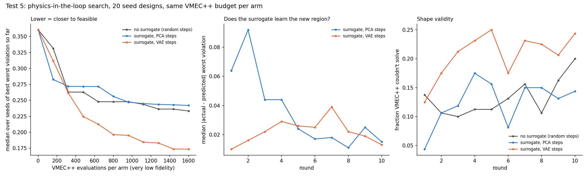
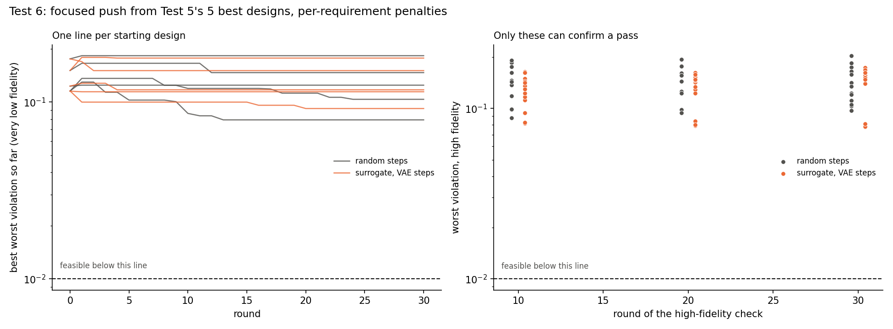
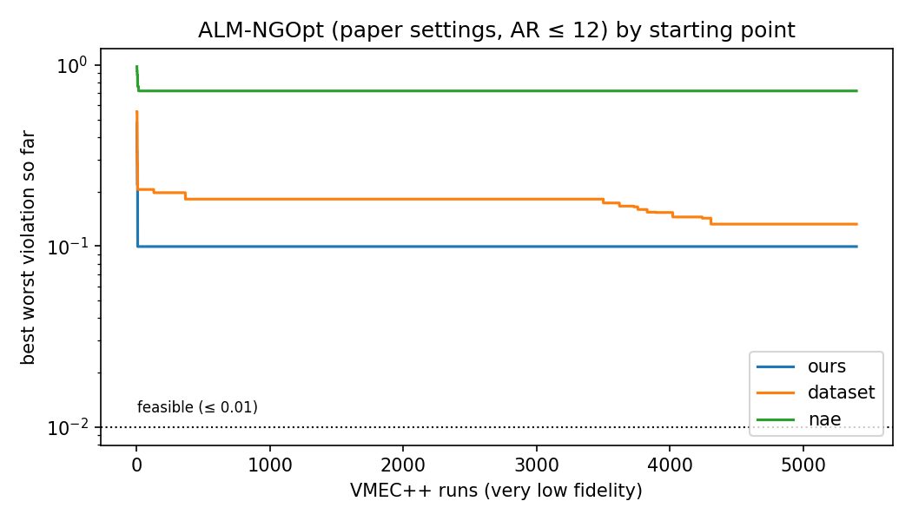
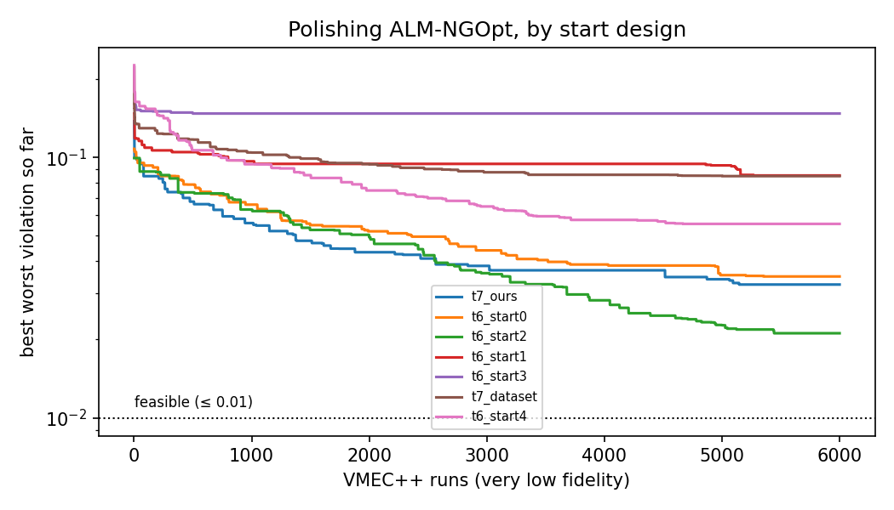

# Plan feasibility tests: results so far

*Run 2026-11-14 to 16 on Leif's M3 Max. These are quick, throwaway checks of the plan's
riskiest assumptions, not the project's real surrogates or search. All use the 68,191
valid designs with 3 field periods.*

| Test | Question | Status | Verdict |
|---|---|---|---|
| 1 | Can a surrogate predict the metrics, especially QI? | ✅ done | **Go.** Use a neural net, not boosted trees, for QI |
| 2 | Does surrogate-guided search improve *real* designs? | ✅ done | **No, not in one shot.** Most shapes break; the surrogate is badly wrong off-data |
| 2b | Same, but searching only along PCA directions | ✅ done | **No.** Worse: 0/40 solved at high fidelity |
| 3 | Can shapes be compressed (PCA vs. VAE) without changing the physics? | ✅ done | **VAE yes**, PCA only at 32 dims. Both blur fine QI detail |
| 4 | Can low-fidelity VMEC++ stand in for high fidelity? | ✅ done | **Yes, as a filter.** Not for the final score |
| 5 | Does a small physics-in-the-loop search work, and does the surrogate help? | ✅ done | **The loop works:** closest design 0.203 → **0.096**. VAE steps best; surrogate + PCA steps no better than random |
| 6 | Can a longer, focused push reach a feasible design? | ✅ done | **No.** Best 0.096 → **0.078**, then stalled. The designs sit at a local optimum where 3–5 requirements fail together |
| 7 | Does the paper's optimizer (ALM-NGOpt) finish the job if started from our best design? | ✅ done | **No, not at a budget we can afford.** 5,400 runs from each of 3 starts: nothing feasible. From our design it found an equally close design with much higher L∇B; from the dataset's best it reached 0.126; from the paper's start 0.72 |
| 8 | Does ALM-NGOpt, retuned to polish, get closer? | ✅ done | **Much closer, not yet feasible.** Best 0.078 → **0.033** at high fidelity (QI and mirror ratio each ~0.03 short). Still improving when the budget ran out |

**Bottom line:** the pieces work (surrogate on known shapes, VAE latent space, cheap
VMEC++ filter), but "optimize the surrogate, then check once" does not. The search walks
off the data, where the surrogate is confidently wrong. **Physics-in-the-loop with small
steps and retraining is required, not optional.** Test 5 confirms it: a small loop
roughly halved the closest design's gap to feasible on a laptop in under an hour. Test 6
showed that local polishing then stalls at ~0.08: to reach feasible we need a better
constrained optimizer or different starting points, not more of the same. Test 7 tried
the paper's constrained optimizer from our best design: in 5,400 runs it didn't get closer
to feasible, so at a matched, laptop-sized budget our loop (0.078) beats it (0.126 from
the dataset's best, 0.72 from its own start). Test 8 retuned that optimizer to polish
instead of explore and more than halved the gap: **0.078 → 0.033**. Details below.

## Test 1: surrogate accuracy

`scripts/feasibility_tests/surrogate_test.py` → `surrogate.json`, `surrogate_qi_parity.png`

Two off-the-shelf models (scikit-learn boosted trees and a 3×256 neural net, MLP),
trained in ~2–3 min on 54.5k designs, tested on 13.6k held-out designs. Inputs are the
81 raw shape coefficients.

**Overall, both are accurate.** R² is 0.92–0.996 on all 7 metrics.

| Metric | R² (trees / MLP) | Typical error (MLP) |
|---|---|---|
| log10(qi) | 0.948 / 0.957 | 0.046 |
| Edge twist | 0.994 / 0.993 | 0.006 |
| Mirror ratio | 0.971 / 0.974 | 0.012 |
| Flux compression | 0.945 / 0.954 | 0.030 |
| Vacuum well | 0.986 / 0.988 | 0.008 |
| L∇B (goal) | 0.924 / 0.916 | 0.30 |
| Aspect ratio (goal) | 0.996 / 0.989 | 0.09 |

**Where it matters (best-QI designs), the MLP is much better.**

| Held-out designs with true log10(qi) < -3 (131 designs) | Trees | MLP |
|---|---|---|
| Average QI error | 0.21 | **0.12** |
| Bias (+ = predicts worse QI than true) | +0.20 | **+0.05** |

Trees flatten out at the good end: they can't predict QI better than what they've seen
often, which is fatal when the target is *beyond* the data. The MLP tracks the diagonal
(see the figure). For scale: the closest design needs log10(qi) to improve by 0.71 to
pass, so the MLP's error is about 1/6 of the gap.

**It can screen candidates.** Ranking held-out designs by predicted worst violation, the
MLP's top 500 (3.7% of the test set) contains **95%** of the truly 100 closest designs.

**Weak spots:** pass/fail right at the limit for **vacuum well (~70% correct within 20%
of the limit)** and **mirror ratio (~85%)**. Vacuum well's limit is normalized by 0.1, so
small absolute errors become large violations. These are two of the constraints the
good-QI designs fail, so they need attention.

**Caveat:** this is a random split, so test designs look like training designs. The real
risk is accuracy on *new* shapes the search proposes, outside the data. That's what Test 2
checks.

## Test 4: low vs. high fidelity

`scripts/feasibility_tests/fidelity_test.py` → `fidelity.json`

50 designs (the 25 closest to feasible + 25 random), evaluated at very low and low
fidelity and compared with high fidelity (the dataset's stored values, which match a fresh
high-fidelity run).

| | Very low | Low | High |
|---|---|---|---|
| Time per design | **3.2 s** | 8.1 s | ~130 s |
| Speedup vs. high | **40×** | 16× | 1× |
| Worst-violation ranking agreement, all 50 (Spearman) | 0.97 | 0.98 | |
| Same, 25 closest only | 0.80 | 0.84 | |
| Worst-violation error, 25 closest (mean / max) | 0.020 / 0.057 | 0.018 / 0.054 | |
| Pass/fail agreement per constraint | 92–100% | 92–100% | |

- **Low fidelity isn't worth it.** It's barely more accurate than very low and 2.5× slower.
- **Very low fidelity is a good filter:** 40× cheaper, and it ranks designs well.
- **But it can't give the final verdict.** Near the limit its error (up to ~0.06) is far
  bigger than the 0.01 pass tolerance, so a design counts as feasible only after a
  high-fidelity check. The **L∇B goal** is its least reliable metric (one design off by
  5.4), so scoring must be high fidelity too.
- Matters for the baseline comparison: ALM-NGOpt optimizes at very low fidelity, so its
  designs must be re-scored at high fidelity.

## Test 2: surrogate-guided search in raw coefficients

`scripts/feasibility_tests/search_test.py` → `search.json`, `search.png`, `search_candidates.csv`

An ensemble of 3 MLPs (Test 1's network) trained on all 68k designs. 20 seed designs:
the 10 closest to feasible, 5 that pass QI, and 5 that pass the other four. For each,
CMA-ES minimizes the *predicted* worst violation (plus a 0.05 safety margin) within a box
of ±r standard deviations per coefficient. Then every result is checked with real VMEC++.

| | Small steps (±0.25σ) | Large steps (±1σ) |
|---|---|---|
| VMEC++ couldn't solve the shape | 14 / 20 | 20 / 20 |
| Feasible | 0 | 0 |
| Real design improved vs. its seed | 3 / 6 solved | none |

- **Most shapes broke:** "boundary poorly shaped / not spectrally condensed." Moving all
  81 coefficients independently roughens the small high-order modes.
- **The surrogate was badly wrong on the new shapes.** Worst-violation error was 0.58 on
  average, vs. 0.06 on held-out real designs (Test 1), and optimistic by a median 0.37.
  Mirror ratio was the worst (error 0.79), then QI (0.31). The search found the
  surrogate's blind spots, not better designs.
- **Ensemble disagreement didn't flag the errors** (Spearman −0.43 between spread and
  error), so it can't serve as a safety check as-is.
- The one bright spot: 3 of 4 solved "passes QI" seeds improved (median −0.29), while
  the closest seeds got worse.

## Test 2b: the same search, but only along PCA directions

`scripts/feasibility_tests/search_pca_test.py` → `search_pca.json`, `search_pca_candidates.csv`;
diagnostic `line_scan.py` → `line_scan.csv`

Idea: restrict steps to the top 16 PCA directions of real designs (99.2% of variance), so
the search can't add wrinkles. Same seeds, surrogate and objective. Steps of ±0.5 and
±1.5 per-direction standard deviations.

| | Small (±0.5) | Large (±1.5) |
|---|---|---|
| Solved at very low fidelity | 4 / 20 | 0 / 20 |
| Solved at high fidelity | **0 / 20** | 0 / 20 |

The 4 that solved at very low fidelity all predicted mirror ratio violation ~0.03–0.07
and got **1.4–2.4**. Again, the search exploited the surrogate's blind spot.

**Line scan (diagnostic):** for 6 seeds, evaluate points 0%, 10%, 25%, 50% and 100% of
the way from the seed to the search's answer (very low fidelity).

| Seed group | Real worst violation along the path (0 → 10% → 25% → 50% → 100%) |
|---|---|
| closest | 0.18 → 0.53 → 1.08 → 1.83 → fails |
| closest | 0.21 → 0.27 → 0.51 → 0.92 → fails |
| passes QI | 0.47 → fails → 0.84 → 1.19 → 1.59 |
| passes QI | 1.05 → 0.95 → 0.89 → fails → fails |
| passes other four | 0.48 → 0.44 → 0.41 → fails → fails |
| passes other four | 0.40 → 0.37 → 0.65 → 1.41 → fails |

- **Not a code bug:** every seed solves at 0%.
- The steps moved mostly low-order shape (m = 1), not wrinkles, so PCA did its job. The
  steps were just too large, and the surrogate's direction is often wrong even at 10%.
- **3 of 6 do improve for the first 10–25%.** So small steps, re-checked with VMEC++, can
  make progress; long jumps on the surrogate alone can't.

## Test 3: compressing shapes, PCA vs. VAE

`scripts/feasibility_tests/compression_test.py` → `compression.json`, `compression.png`, `compression_designs.csv`

PCA and a small VAE (JAX, 256-256 encoder/decoder) at latent sizes 4, 8, 16, 32, trained
on raw coefficients (one global scale; per-coefficient standardization was much worse).
Checked with VMEC++ at very low fidelity, plus a high-fidelity spot check.

**A. Rebuild 100 held-out designs** (50 closest + 50 random):

| Latent size | VMEC++ failures (PCA / VAE) | Worst-violation change (PCA / VAE) | QI change, log10 (PCA / VAE) |
|---|---|---|---|
| 4 | 18 / **1** | 0.83 / **0.19** | 0.48 / **0.37** |
| 8 | 12 / **2** | 0.29 / **0.14** | 0.55 / **0.19** |
| 16 | 6 / **0** | 0.24 / **0.14** | 0.35 / **0.17** |
| 32 | 6 / 2 | **0.10** / 0.14 | **0.10** / 0.29 |

High-fidelity spot check at size 16: VAE worst-violation change 0.15 vs. PCA 0.32; QI
change 0.35 vs. 0.81. Standardized PCA-16: 41 of 100 failed.

**B. New random samples:** VMEC++ solves 76–84% of VAE samples vs. 26–52% of PCA's. VAE
samples look like the dataset (median log10(qi) ≈ −1.7), and none is near-feasible.

**C. Blending a good-QI design with a good-everything-else design:** valid along the path
for 6/15 (raw), 11/15 (PCA-16), 12/15 (VAE-16). A midpoint beat both ends on only 1 of 5
paths. Simple blending doesn't cross the gap.

- **The VAE is the better latent space:** valid shapes and generation, at 4–16 dims.
- **But compression blurs QI** by ~0.17–0.35 in log10, up to half the gap the closest
  design needs to close. Final designs must be refined in the full 81 coefficients.
- This VAE is untuned (β = 0.05, 80 epochs). Lower β or property heads should help.

## Test 5: a small physics-in-the-loop search

`scripts/feasibility_tests/loop_test.py` → `loop.json`, `loop.png`, `loop_history.csv`, `loop_final_*.csv`

Same 20 seeds. Three arms with the **same VMEC++ budget**: 10 rounds × 8 designs per seed
at very low fidelity = 1,600 runs per arm. Each arm keeps a design only if VMEC++ says
it's better, with a step size that grows after progress and halves otherwise.

- **No surrogate (control):** 8 random small steps along the top 16 PCA directions.
- **Surrogate, PCA steps:** score 4,000 random small PCA steps with the surrogate, send
  the best 8 (spread out) to VMEC++, fine-tune the surrogate on the results each round.
- **Surrogate, VAE steps:** same, but steps are taken in a 16-dim VAE latent space and only
  the *change* is applied to the design (x + dec(z + dz) − dec(z)), so the VAE's QI blur
  doesn't touch the design.

Surrogate predictions are anchored to what VMEC++ measured at the current design, which
removes the offset that broke Tests 2/2b. 55 min on the laptop. Final designs re-checked
at high fidelity.

| After 1,600 runs per arm | No surrogate | Surrogate, PCA | Surrogate, VAE |
|---|---|---|---|
| Median best worst violation, very low fidelity (start 0.36) | 0.233 | 0.242 | **0.174** |
| Seeds improved, high fidelity | 17 / 17 solved | 16 / 16 solved | 17 / 17 solved |
| Best design, high fidelity (dataset best: 0.203) | 0.132 | 0.141 | **0.096** |
| Seed where this arm did best | 4 | 7 | **9** |
| 10 closest seeds: mean worst, high fidelity (start 0.230) | 0.181 | 0.187 | **0.156** |
| "Passes QI" seeds: median change, high fidelity | −0.52 | −0.69 | −0.69 |
| Shapes VMEC++ couldn't solve | 13% | 13% | 21% |
| Final designs that failed at high fidelity | 3 | 4 | 3 |
| Feasible | 0 | 0 | 0 |

- **The loop works.** Every arm improved every seed at very low fidelity, and every final
  design that solved at high fidelity beat its seed there too. **All three found designs closer to feasible than anything in the
  182k-design dataset.** The best (VAE arm) has worst violation 0.096, with the remaining
  gap spread evenly: mirror 0.096, vacuum well 0.094, QI 0.041 (log10 qi = −3.36 vs. the
  −3.5 limit). Its L∇B is 3.9 and aspect ratio 10.3.
- **VAE steps did best** and were still improving at round 10. **Caveat:** for the same
  step setting, VAE steps were ~4× larger in coefficient terms (median 0.69 vs. 0.18
  per-coefficient std units), which also explains its higher failure rate. Some of its
  edge may come from taking bigger steps, not from the VAE itself. A matched-step rerun
  would separate the two.
- **Surrogate + PCA steps were no better than random steps,** even though fine-tuning
  worked: its prediction error fell from 0.06–0.09 to ~0.015 by round 5. With small
  steps, random trial and error is already efficient, so the surrogate's value has to
  come from taking bigger, smarter steps.
- **Mirror ratio still bit first.** Before fine-tuning, the surrogate favored steps that
  helped QI but broke mirror ratio. Fine-tuning fixed that within a few rounds.
- **Very low fidelity isn't enough to finish.** 10 of 60 final designs that solved at very
  low fidelity failed at high fidelity. Check several candidates per seed at high fidelity.

## Test 6: a focused push for a feasible design

`scripts/feasibility_tests/push_test.py` → `push.json`, `push.png`, `push_history.csv`, `push_checked_designs.jsonl`

Starts from Test 5's 5 best designs (high fidelity 0.096–0.150). Two arms, same budget:
random PCA steps vs. surrogate-scored VAE steps. 30 rounds × 16 designs each = 2,400
very-low-fidelity runs per arm, plus 45 high-fidelity checks per arm (the 3 best
unchecked candidates per design every 10 rounds). Two changes from Test 5:

- **Per-requirement penalties:** minimize the weighted sum of each requirement's shortfall
  (aiming 0.02 past each limit), multiplying a requirement's weight by 1.5 every round it
  still fails.
- **High-fidelity checks during the run**, since only those can confirm a pass.

75 min on the laptop.

| Starting design (high fidelity) | Random steps | Surrogate + VAE steps |
|---|---|---|
| 0.096 | 0.088 | **0.078** |
| 0.122 | 0.118 | **0.112** |
| 0.132 | **0.111** | 0.135 |
| 0.141 | 0.144 | **0.123** |
| 0.150 | 0.156 | **0.149** |
| Feasible | 0 | 0 |
| Very-low-fidelity runs VMEC++ couldn't solve | 8% | 17% |

- **No feasible design.** The best is 0.078 (QI 0.072, mirror 0.078, vacuum well 0.003),
  down from 0.096. Most of the gain came in the first 10 rounds.
- **The search stalled at a local optimum.** Every design's step size shrank to the
  minimum by round 20–30: no small step in any direction improved it. The remaining
  shortfalls are spread over 3–5 requirements at once, around 0.08–0.15 each. That's the
  QI / mirror / vacuum-well tradeoff wall.
- **My penalty scheme didn't do its job.** Because almost every requirement kept failing,
  every weight grew at the same rate and hit the cap, so it reduced to "minimize the sum
  of shortfalls". It never shifted effort toward the stubborn requirement. A proper
  augmented Lagrangian scales each multiplier by *how much* a requirement fails.
- **The surrogate learned the local region almost perfectly** (prediction error 0.023 →
  0.002), but that didn't help: the limit is the landscape, not the prediction.
- **VAE steps still edged out random steps** (4 of 5 designs), but with twice the failure
  rate, and the step-size caveat from Test 5 still applies.
- **The cheap simulator is now as noisy as our progress.** On 77 designs checked at both
  fidelities, very low vs. high fidelity differed by 0.017 on average (max 0.058). Per-round
  gains near the end are smaller than that, so the loop is partly steering on noise.

## Test 7: warm-starting the paper's optimizer (ALM-NGOpt)

`scripts/feasibility_tests/alm_warmstart_test.py` → `alm_warmstart.json`, `alm_warmstart.png`, `alm_checked_designs.jsonl`

The paper's Benchmark 3 baseline, run with its exact settings (constellaration v0.2.6
`launch_alm_mhd_stable_stellarator.py`: very low fidelity, 1,500 runs in the first outer
iteration, +300 per iteration, search box ±0.33, aspect ratio ≤ 12), from three starts.
3 outer iterations = 5,400 runs per start (the paper allows up to 50 iterations, roughly
440k runs). The ALM loop is copied from the package so every run is logged; the optimizer
logic is unchanged. The best designs per start were re-checked at high fidelity.
3.1 h on the laptop (12 workers).

| Start | Start, worst violation | Best found in 5,400 runs (high fidelity) | Feasible |
|---|---|---|---|
| **Ours** (Test 6 best) | 0.078 | **0.078** (run 3,742; L∇B 5.1 → **9.1**, AR 10.5 → 11.8) | 0 |
| Dataset's closest design | 0.203 | 0.126 (L∇B 8.5, AR 12.2) | 0 |
| Paper's own start (near-axis shape) | 0.98 (very low fidelity) | 0.72 (very low fidelity) | 0 |

- **No feasible design from any start.** ALM-NGOpt didn't close the gap at this budget.
- **From our design it made no progress toward feasible**, but found a design just as
  close (0.0776 vs. 0.0778) with a much better objective: L∇B 9.1 instead of 5.1, at
  aspect ratio 11.8. That's a better trade-off for the final score once we're feasible.
- **Its own chosen point drifted away each iteration** (ours: 0.20 → 0.42 → 0.29; dataset:
  0.57 → 0.69 → 0.26). Early on, ALM weights the objective (L∇B) heavily and the
  requirements lightly, and searches a wide box, so it trades feasibility for L∇B and
  pushes aspect ratio up to its limit. It only tightens up over many more iterations.
- **Matched-budget comparison (the project's main question):** with ~5,000 cheap runs,
  ALM-NGOpt from its usual start gets to 0.72; from the dataset's best, 0.126. Our loop
  (Tests 5–6, ~4,000 cheap runs) got to 0.078. Caveat: our loop started from 20 seeds,
  the ALM runs from one.
- **Very slow shapes:** from the dataset start, 645 runs took over a minute each (up to
  3 min), so that arm took 2.2 h instead of ~35 min.

## Test 8: ALM-NGOpt retuned to polish

`scripts/feasibility_tests/polish_test.py` → `polish.json`, `polish.png`, `polish_checked_designs.jsonl`

Reading the package's ALM code showed why Test 7 wandered: the search box never shrinks
(`bounds_reduction_factor` is unused, so it stays at ±0.33), constraints are in raw units
(a mirror-ratio shortfall weighs ~10× less than the same QI shortfall),
`penalty_parameters_initial` is ignored, and it always accepts Nevergrad's recommendation
even when that's worse. Test 8 keeps the same ALM + NGOpt machinery and changes:

- constraints = the benchmark's own normalized violations + a 0.02 margin, plus aspect
  ratio ≤ 12
- objective (20 − L∇B)/20 × 0.05: only a tie-breaker until feasible
- penalties start at 100; box ±0.05 that shrinks ×0.7 whenever an outer iteration doesn't
  improve (min 0.005)
- each outer iteration keeps its best evaluated point
- 20 outer iterations × 300 runs = 6,000 very-low-fidelity runs per start

7 starts: the best design from each of Test 6's 5 seeds, plus Test 7's two best. The 6
closest designs per start were re-checked at high fidelity. 6.0 h overnight.

| Start (high fidelity) | Best, very low fidelity | Best, high fidelity | L∇B | AR |
|---|---|---|---|---|
| Test 7, ours (0.078) | 0.033 | **0.033** | 8.3 | 12.2 |
| Test 6, seed 2 (0.111) | **0.021** | 0.044 | 7.5 | 12.3 |
| Test 6, seed 0 (0.078) | 0.035 | 0.046 | 4.2 | 11.0 |
| Test 6, seed 4 (0.149) | 0.056 | 0.080 | 8.3 | 10.7 |
| Test 6, seed 1 (0.112) | 0.085 | 0.084 | 0.1 | 9.3 |
| Test 7, dataset (0.126) | 0.085 | 0.100 | 8.2 | 12.2 |
| Test 6, seed 3 (0.123) | 0.147 | not checked | | |

- **No feasible design, but the best gap more than halved: 0.078 → 0.033.** That design
  misses only QI (0.031) and mirror ratio (0.033), plus vacuum well by a hair (0.004),
  and keeps a good L∇B (8.3).
- **The tuning was the difference.** From the same start, the paper's settings (Test 7)
  made no progress in 5,400 runs; the polishing settings reached 0.033 in 6,000.
- **The best runs were still improving** when the budget ran out (best start: 0.036 at
  3,000 runs, 0.025 at 4,500, 0.021 at 6,000, very low fidelity), but the box had shrunk
  to its minimum. 3 of 7 starts barely moved.
- **The cheap simulator's error is now the bottleneck.** Seed 2's best was 0.021 at very
  low fidelity but 0.044 at high. The 0.02 margin wasn't enough there, though for the best
  start the two fidelities agreed (0.033 vs. 0.033).
- **L∇B was sacrificed on some starts** (seed 1 fell to 0.1, seed 0 from 5.1 to 4.2): with
  the objective only a tie-breaker, the optimizer gives it up freely. Fine for reaching
  feasible, but the final score needs it back.
- Aspect ratios ended slightly over 12 (Benchmark 3 itself has no aspect-ratio limit).

## What this means for the plan

1. **Surrogate:** a neural net is viable for QI *on known shapes*. Boosted trees are a
   poor fit for the region we need to reach.
2. **Physics-in-the-loop is the core, not an add-on.** One-shot surrogate optimization
   failed in both Test 2 and 2b. The loop should be: propose small steps (≈ 10–25% of
   what was tried here) with the surrogate → check with very low fidelity VMEC++ (3 s) →
   **add the results to the training data and retrain** → repeat. Confirm finalists at
   high fidelity (~2 min).
3. **Keep the search on valid shapes.** Search in a VAE latent space (Test 3), and/or add
   a "will VMEC++ solve this?" classifier. The dataset's ~23k invalid rows are likely
   ready-made training data for that (to check).
4. **Mirror ratio is the surrogate's worst blind spot off-data,** then QI and vacuum
   well. Ensemble spread didn't catch the errors, so the uncertainty estimate needs work
   (e.g. a trust region around evaluated designs rather than trusting spread).
5. **Refine finalists in full coefficients.** The VAE blurs QI too much for the last step.
6. **Seed choice matters:** "passes QI" seeds improved most in Tests 2 and 5.
7. **The loop is the method, and the VAE is the search space (Test 5).** It roughly
   halved the closest design's gap in 1,600 cheap runs per arm. Next: separate the VAE
   effect from step size, run longer (the VAE arm hadn't stopped improving), and check
   more finalists at high fidelity.
8. **The surrogate must earn its place.** Against the random-step control, it hasn't yet.
   Keep the control in every experiment: it's our honest "does ML help" comparison.
9. **Local polishing has hit a wall at ~0.08 (Test 6).** Reaching feasible needs one of:
   a real constrained optimizer (the paper's ALM-NGOpt, warm-started from our best
   designs, would be a clean test: how many runs does it need from our designs vs. from
   its usual start?); more diverse starting points (other aspect ratios, other seeds);
   or bigger, smarter moves than a local trust region allows.
10. **Near the finish, very low fidelity is too noisy to steer by.** Switch the final
    stage to low or high fidelity.
11. **ALM-NGOpt as-is isn't a cheap finisher (Test 7).** At a laptop-sized budget it
    doesn't get closer to feasible than our loop, from any start. That's good news for the
    baseline comparison. To actually reach feasible, try: ALM with a small search box
    (e.g. ±0.05 instead of ±0.33) and higher starting penalties, so it polishes instead of
    exploring; or many more ALM iterations (the paper's full budget is ~100× ours).
12. **A tuned constrained optimizer is the finisher (Test 8).** Polishing ALM halved the
    best gap to 0.033 overnight and was still improving. To cross the line: continue the
    best 2–3 designs with a reset box, and run the last stretch at high fidelity (or with
    a bigger margin), since very-low-fidelity error (~0.02) is now as big as the remaining
    gap. Then bring L∇B back up while staying feasible.
